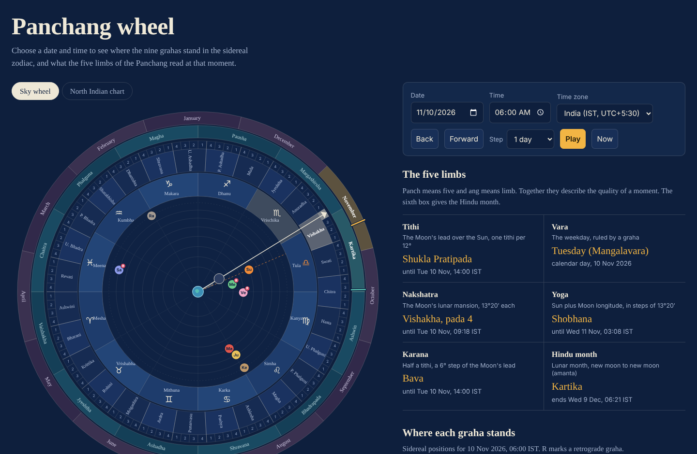
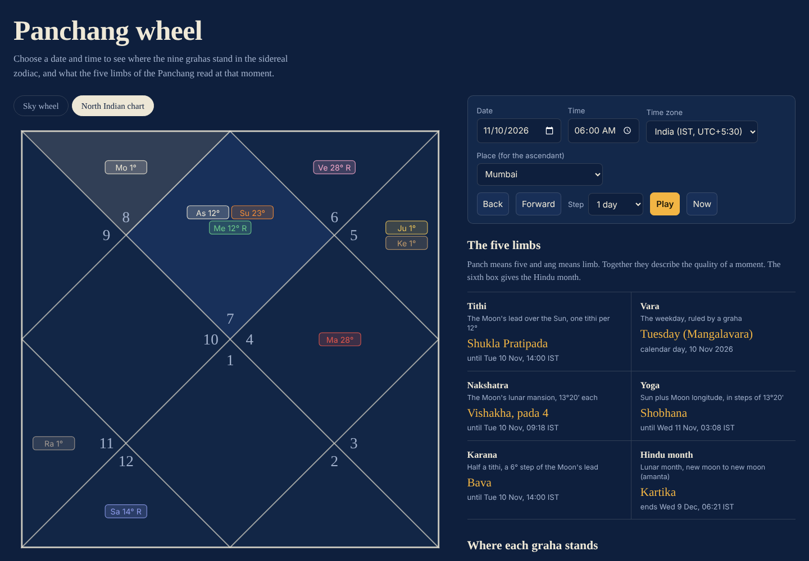
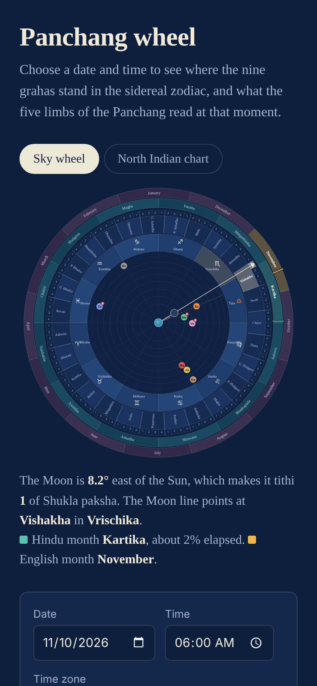

# Panchang Wheel

An interactive sky wheel and open API for the **Panchang**, the Hindu almanac. Pick any date and time and see where the nine grahas stand in the sidereal zodiac, which tithi, nakshatra, yoga and karana are running, which Hindu and English month it is, and how the same moment looks in a North Indian chart.

**Live demo:** `https://vaibhavshah123.github.io/panchang-wheel`



| North Indian chart | On a phone |
|---|---|
|  |  |

Everything is calculated from astronomy. There is no database and no external data feed: the page runs entirely in the visitor's browser, and the optional API runs the same maths on a small Node server.

---

## Contents

1. [What you get](#1-what-you-get)
2. [Quick start](#2-quick-start)
3. [Repository layout](#3-repository-layout)
4. [Understanding the Panchang](#4-understanding-the-panchang)
5. [The sky behind the Panchang](#5-the-sky-behind-the-panchang)
6. [The twelve rashis](#6-the-twelve-rashis)
7. [The 27 nakshatras and their padas](#7-the-27-nakshatras-and-their-padas)
8. [The five limbs in detail](#8-the-five-limbs-in-detail)
9. [Beyond the five limbs: months, seasons and years](#9-beyond-the-five-limbs-months-seasons-and-years)
10. [The nine grahas, retrograde motion and the nodes](#10-the-nine-grahas-retrograde-motion-and-the-nodes)
11. [Lagna, houses and the North Indian chart](#11-lagna-houses-and-the-north-indian-chart)
12. [How to read the wheel](#12-how-to-read-the-wheel)
13. [How the calculations work](#13-how-the-calculations-work)
14. [Accuracy, validation and limits](#14-accuracy-validation-and-limits)
15. [The API](#15-the-api)
16. [Publishing on GitHub](#16-publishing-on-github)
17. [Embedding and URL parameters](#17-embedding-and-url-parameters)
18. [Glossary](#18-glossary)
19. [FAQ](#19-faq)
20. [Roadmap](#20-roadmap)
21. [Contributing](#21-contributing)
22. [Credits, licence and disclaimer](#22-credits-licence-and-disclaimer)

---

## 1. What you get

**The wheel page** (`docs/index.html`, one self-contained file)

- Earth at the centre, with the Sun, Moon, Mars, Mercury, Jupiter, Venus, Saturn, Rahu and Ketu placed by their actual sidereal longitude for the chosen moment
- Concentric rings for the 12 rashis, the 27 nakshatras, the 108 padas, the 12 Hindu lunar months and the 12 English months
- The Moon line (the "clock hand") pointing at the current nakshatra, pada and rashi, and a wedge showing the Moon's lead over the Sun, which is the tithi
- Moon phase on the Moon marker, retrograde badges, and a short "today" line on each month ring
- The five limbs (tithi, vara, nakshatra, yoga, karana) with the time each one ends, plus the Hindu month
- A North Indian chart with the ascendant for a chosen place
- Date, time and time zone controls, step buttons, an animation, and shareable links

**The API** (`panchang-api/`, Node.js)

- `/api/panchang` for the positions, Panchang and transit details of one moment
- `/api/transits` for every sign change, nakshatra change and retrograde turning point in a date range
- JSON in, JSON out, CORS enabled, with tests

---

## 2. Quick start

**Use the page.** Open `docs/index.html` in any browser. It needs no server and no internet connection.

**Run the API.**

```bash
cd panchang-api
npm install
npm start          # http://localhost:3000
npm test           # runs the checks against known dates
```

Then try:

```
http://localhost:3000/api/panchang?date=2026-11-10&time=06:30&tz=IST
http://localhost:3000/api/transits?from=2026-11-10&to=2027-06-30&bodies=Jupiter,Saturn
```

---

## 3. Repository layout

```
panchang-wheel/
├── README.md                  this file
├── LICENSE                    MIT licence for this project
├── THIRD_PARTY_NOTICES.md     licence of the astronomy library used
├── CONTRIBUTING.md
├── .gitignore
├── .github/
│   ├── workflows/ci.yml       runs the API tests on every push
│   └── ISSUE_TEMPLATE/        bug report and accuracy report forms
├── docs/                      what GitHub Pages serves
│   ├── index.html             the wheel page (a single self-contained file)
│   ├── .nojekyll
│   └── img/                   screenshots used in this README
└── panchang-api/
    ├── README.md              full API reference
    ├── package.json
    ├── server.js              plain Node server
    ├── vercel.json
    ├── api/                   Vercel serverless functions
    ├── src/core.js            the calculations
    ├── src/api.js             validation and routing
    └── test/smoke.js          checks against known dates
```

---

## 4. Understanding the Panchang

### 4.1 What the word means

*Panchang* (pañcāṅga) joins *pancha*, five, and *anga*, limb. A Panchang describes a moment, or a day, by five quantities:

| Limb | Sanskrit | What it measures | Based on |
|---|---|---|---|
| 1 | **Tithi** | the lunar day | the angle between the Moon and the Sun |
| 2 | **Vara** | the weekday | the day of the week |
| 3 | **Nakshatra** | the lunar mansion | the Moon's position against the stars |
| 4 | **Yoga** | the Sun-Moon combination | the sum of the Sun's and Moon's positions |
| 5 | **Karana** | the half-tithi | half of the Moon's angle step |

Four of the five come from the Sun and the Moon alone. Only the weekday does not.

### 4.2 What it is used for

A printed or digital Panchang is used to choose auspicious times (*muhurta*) for events, to fix the dates of festivals and fasts (many fall on a particular tithi in a particular month), to mark death anniversaries (*shraddha*) and birthdays by the lunar calendar, and as the starting point for reading a birth chart. This project shows the astronomy behind those entries. It does not decide what is auspicious, and it does not replace a Panchang prepared for your place and tradition.

### 4.3 Why it is a calendar and a clock at once

The Moon returns to the same angle from the Sun every 29.53 days, which sets the lunar month. The Moon returns to the same star background every 27.32 days. The Sun takes a year to go round. A Panchang keeps track of all three cycles together, which is why it can name the day inside the month (tithi), the star the Moon is passing (nakshatra), and the month and year (see section 9).

---

## 5. The sky behind the Panchang

### 5.1 The view from Earth

Vedic astronomy places Earth at the centre and records the direction in which each body is seen. This is called the **geocentric** view. It is the view this project draws, and the reason Earth sits in the middle of the wheel.

### 5.2 The ecliptic and the zodiac

Seen from Earth, the Sun traces a great circle across the sky over a year. That circle is the **ecliptic**. The Moon and the planets stay close to it, so a band about 16 degrees wide around the ecliptic, the **zodiac**, is where all the action happens.

Positions along the ecliptic are measured as **longitude**, from 0 to 360 degrees. The zodiac is divided into:

- **12 rashis** (signs) of 30 degrees each
- **27 nakshatras** of 13 degrees 20 minutes each (360 / 27)
- **108 padas** of 3 degrees 20 minutes each (a quarter of a nakshatra)

Nine padas make exactly one rashi (9 x 3 degrees 20 minutes = 30 degrees), and two and a quarter nakshatras make one rashi.

### 5.3 Sidereal and tropical zodiacs

There are two ways to fix 0 degrees:

- The **tropical** zodiac starts at the March equinox, where the Sun crosses the celestial equator. It is tied to the seasons. Western astrology uses it.
- The **sidereal** zodiac starts at a point fixed against the stars. The Panchang and Vedic astrology use it.

The two used to agree. Earth's axis slowly wobbles (*precession*), which moves the equinox backwards against the stars by about 50.3 arc-seconds a year, roughly one degree every 72 years. The gap between the two zodiacs is called the **ayanamsa**.

### 5.4 The Lahiri ayanamsa

Several ayanamsa definitions exist. This project uses the **Lahiri** (Chitrapaksha) ayanamsa, the standard adopted by the Government of India's Calendar Reform Committee and the most widely used in Indian Panchangs. It is anchored so that the star Spica (Chitra) sits at 0 degrees Tula, exactly 180 degrees from the start of Mesha. At the year 2000 it is 23 degrees 51 minutes 11 seconds (23.85306 degrees), and it grows with precession. In late 2026 it is about **24.23 degrees**.

In practice this means that the Sun, which a Western horoscope would place in the middle of Scorpio in mid-November, is placed by this project in Tula (Libra), about 24 degrees earlier. Section 13 shows how it is applied.

### 5.5 Geocentric apparent positions

The positions used here are *apparent*: they include the small shift from the finite speed of light (aberration), so they match what an observer sees. Parallax from the observer's place on Earth is not applied, so the Moon's position can differ from a topocentric reading by up to about one degree. This is why the Panchang of a date is the same for everyone, wherever they stand, except for the ascendant (section 11).

---

## 6. The twelve rashis

The sidereal zodiac begins at 0 degrees Mesha and runs onward through the signs in this order. In the wheel, Mesha starts at the 9 o'clock position and the signs run counter-clockwise.

| # | Rashi | English | Symbol | Begins at | Lord |
|---|---|---|---|---|---|
| 1 | Mesha | Aries | ♈ | 0° | Mars |
| 2 | Vrishabha | Taurus | ♉ | 30° | Venus |
| 3 | Mithuna | Gemini | ♊ | 60° | Mercury |
| 4 | Karka | Cancer | ♋ | 90° | Moon |
| 5 | Simha | Leo | ♌ | 120° | Sun |
| 6 | Kanya | Virgo | ♍ | 150° | Mercury |
| 7 | Tula | Libra | ♎ | 180° | Venus |
| 8 | Vrischika | Scorpio | ♏ | 210° | Mars |
| 9 | Dhanu | Sagittarius | ♐ | 240° | Jupiter |
| 10 | Makara | Capricorn | ♑ | 270° | Saturn |
| 11 | Kumbha | Aquarius | ♒ | 300° | Saturn |
| 12 | Meena | Pisces | ♓ | 330° | Jupiter |

Notes:

- The *lord* is the graha traditionally said to rule the sign. Sun and Moon rule one sign each; the other five rule two.
- Each rashi's start also marks a **sankranti**, the day the Sun enters it. Makara Sankranti (the Sun entering Makara) and Mesha Sankranti are the best known.

---

## 7. The 27 nakshatras and their padas

A nakshatra is a stretch of 13 degrees 20 minutes of the zodiac, named after a star or star group in it. The Moon takes about a day to cross one, so "the nakshatra" of a day is where the Moon is.

| # | Nakshatra | Begins at (sidereal longitude) | Lies in | Lord |
|---|---|---|---|---|
| 1 | Ashwini | 0°00′ | Mesha 0°00′ to 13°20′ | Ketu |
| 2 | Bharani | 13°20′ | Mesha 13°20′ to 26°40′ | Venus |
| 3 | Krittika | 26°40′ | Mesha 26°40′ to Vrishabha 10°00′ | Sun |
| 4 | Rohini | 40°00′ | Vrishabha 10°00′ to 23°20′ | Moon |
| 5 | Mrigashira | 53°20′ | Vrishabha 23°20′ to Mithuna 6°40′ | Mars |
| 6 | Ardra | 66°40′ | Mithuna 6°40′ to 20°00′ | Rahu |
| 7 | Punarvasu | 80°00′ | Mithuna 20°00′ to Karka 3°20′ | Jupiter |
| 8 | Pushya | 93°20′ | Karka 3°20′ to 16°40′ | Saturn |
| 9 | Ashlesha | 106°40′ | Karka 16°40′ to 30°00′ | Mercury |
| 10 | Magha | 120°00′ | Simha 0°00′ to 13°20′ | Ketu |
| 11 | Purva Phalguni | 133°20′ | Simha 13°20′ to 26°40′ | Venus |
| 12 | Uttara Phalguni | 146°40′ | Simha 26°40′ to Kanya 10°00′ | Sun |
| 13 | Hasta | 160°00′ | Kanya 10°00′ to 23°20′ | Moon |
| 14 | Chitra | 173°20′ | Kanya 23°20′ to Tula 6°40′ | Mars |
| 15 | Swati | 186°40′ | Tula 6°40′ to 20°00′ | Rahu |
| 16 | Vishakha | 200°00′ | Tula 20°00′ to Vrischika 3°20′ | Jupiter |
| 17 | Anuradha | 213°20′ | Vrischika 3°20′ to 16°40′ | Saturn |
| 18 | Jyeshtha | 226°40′ | Vrischika 16°40′ to 30°00′ | Mercury |
| 19 | Mula | 240°00′ | Dhanu 0°00′ to 13°20′ | Ketu |
| 20 | Purva Ashadha | 253°20′ | Dhanu 13°20′ to 26°40′ | Venus |
| 21 | Uttara Ashadha | 266°40′ | Dhanu 26°40′ to Makara 10°00′ | Sun |
| 22 | Shravana | 280°00′ | Makara 10°00′ to 23°20′ | Moon |
| 23 | Dhanishta | 293°20′ | Makara 23°20′ to Kumbha 6°40′ | Mars |
| 24 | Shatabhisha | 306°40′ | Kumbha 6°40′ to 20°00′ | Rahu |
| 25 | Purva Bhadrapada | 320°00′ | Kumbha 20°00′ to Meena 3°20′ | Jupiter |
| 26 | Uttara Bhadrapada | 333°20′ | Meena 3°20′ to 16°40′ | Saturn |
| 27 | Revati | 346°40′ | Meena 16°40′ to 30°00′ | Mercury |

Notes:

- The **lord** column is the Vimshottari dasha lord. The nine lords repeat in the fixed order Ketu, Venus, Sun, Moon, Mars, Rahu, Jupiter, Saturn, Mercury, three times round.
- The **pada** (quarter) is 3 degrees 20 minutes. Pada 1 is the first quarter from the start of the nakshatra. The 108 padas are what the thin ring just outside the nakshatra ring numbers 1 to 4.
- Each nakshatra is shown on the wheel by an abbreviated name where *P.* means Purva (former) and *U.* means Uttara (latter).
- This project uses 27 equal nakshatras, the standard in most Panchangs. Some texts add a 28th, Abhijit, between Uttara Ashadha and Shravana. It is not used here.

---

## 8. The five limbs in detail

### 8.1 Tithi

A **tithi** is the time the Moon takes to gain 12 degrees on the Sun. Thirty tithis make one lunar month, because 30 x 12 = 360.

```
elongation = (Moon longitude - Sun longitude) mod 360
tithi number (1 to 30) = floor(elongation / 12) + 1
```

- The tithi is not tied to the clock. Because the Moon's speed changes, a tithi lasts between roughly **20 and 27 hours**, and a tithi can begin or end at any hour. A civil day usually contains parts of two tithis, and occasionally a tithi begins and ends between two sunrises and so goes unnamed in a sunrise-based Panchang.
- The 30 tithis split into two halves, called **pakshas** (fortnights):
  - **Shukla paksha**, the bright half, from new moon to full moon (tithis 1 to 15)
  - **Krishna paksha**, the dark half, from full moon to new moon (tithis 16 to 30)
- Each paksha has the same 15 names. The 15th of the bright half is **Purnima** (full moon), and the 15th of the dark half is **Amavasya** (new moon).

| Shukla paksha | Krishna paksha | Name | Moon-Sun angle at start (Shukla / Krishna) |
|---|---|---|---|
| 1 | 16 | Pratipada | 0° / 180° |
| 2 | 17 | Dwitiya | 12° / 192° |
| 3 | 18 | Tritiya | 24° / 204° |
| 4 | 19 | Chaturthi | 36° / 216° |
| 5 | 20 | Panchami | 48° / 228° |
| 6 | 21 | Shashthi | 60° / 240° |
| 7 | 22 | Saptami | 72° / 252° |
| 8 | 23 | Ashtami | 84° / 264° |
| 9 | 24 | Navami | 96° / 276° |
| 10 | 25 | Dashami | 108° / 288° |
| 11 | 26 | Ekadashi | 120° / 300° |
| 12 | 27 | Dwadashi | 132° / 312° |
| 13 | 28 | Trayodashi | 144° / 324° |
| 14 | 29 | Chaturdashi | 156° / 336° |
| 15 | 30 | Purnima (Shukla) or Amavasya (Krishna) | 168° / 348° |

In a printed Panchang the tithi that "belongs" to a day is usually the one running at sunrise, and a festival tithi follows its own rule set. This project reports the tithi running at the exact moment you choose, and it also reports when that tithi ends.

### 8.2 Vara

The **vara** is the weekday. Each has a lord:

| Weekday | Sanskrit name | Lord |
|---|---|---|
| Sunday | Ravivara (Adityavara) | Sun |
| Monday | Somavara | Moon |
| Tuesday | Mangalavara | Mars |
| Wednesday | Budhavara | Mercury |
| Thursday | Guruvara (Brihaspativara) | Jupiter |
| Friday | Shukravara | Venus |
| Saturday | Shanivara | Saturn |

The order of lords comes from the planetary hours (*hora*): the seven classical planets, taken in order of decreasing orbital period (Saturn, Jupiter, Mars, Sun, Venus, Mercury, Moon), rule the hours one after another. The planet ruling the first hour of the day names the day. Stepping through 24 hours at a time lands on every third planet in that list, which gives the weekday sequence.

A traditional Hindu day runs from sunrise to the next sunrise, so the hours after midnight and before sunrise still belong to the previous vara. **This project uses the calendar weekday of the time zone you choose and does not switch at sunrise.** (See [Roadmap](#20-roadmap).)

### 8.3 Nakshatra (as a limb)

The nakshatra limb is the nakshatra the Moon is in, with its pada (section 7).

```
nakshatra number = floor(Moon longitude / 13.3333) + 1
pada = floor((Moon longitude mod 13.3333) / 3.3333) + 1
```

The Moon's speed varies between about 11.8 and 15.4 degrees a day, so a nakshatra lasts roughly **21 to 27 hours**.

### 8.4 Yoga

A **yoga** (in this sense, not the exercise system) is a combination of the Sun's and Moon's positions. It advances by 13 degrees 20 minutes each time the *sum* of their longitudes grows by that amount.

```
yoga number (1 to 27) = floor(((Sun longitude + Moon longitude) mod 360) / 13.3333) + 1
```

There are 27 yogas, and the sum moves about 13 to 14 degrees a day, so a yoga lasts about a day.

| # | Yoga | Begins when Sun + Moon reach |
|---|---|---|
| 1 | Vishkambha | 0°00′ |
| 2 | Priti | 13°20′ |
| 3 | Ayushman | 26°40′ |
| 4 | Saubhagya | 40°00′ |
| 5 | Shobhana | 53°20′ |
| 6 | Atiganda | 66°40′ |
| 7 | Sukarma | 80°00′ |
| 8 | Dhriti | 93°20′ |
| 9 | Shula | 106°40′ |
| 10 | Ganda | 120°00′ |
| 11 | Vriddhi | 133°20′ |
| 12 | Dhruva | 146°40′ |
| 13 | Vyaghata | 160°00′ |
| 14 | Harshana | 173°20′ |
| 15 | Vajra | 186°40′ |
| 16 | Siddhi | 200°00′ |
| 17 | Vyatipata | 213°20′ |
| 18 | Variyana | 226°40′ |
| 19 | Parigha | 240°00′ |
| 20 | Shiva | 253°20′ |
| 21 | Siddha | 266°40′ |
| 22 | Sadhya | 280°00′ |
| 23 | Shubha | 293°20′ |
| 24 | Shukla | 306°40′ |
| 25 | Brahma | 320°00′ |
| 26 | Indra | 333°20′ |
| 27 | Vaidhriti | 346°40′ |

Tradition marks some yogas as unfavourable for starting new work. The list most commonly given is Vishkambha, Atiganda, Shula, Ganda, Vyaghata, Vajra, Vyatipata, Parigha and Vaidhriti. Texts and regions differ, and this project only names the yoga, it does not grade it.

### 8.5 Karana

A **karana** is half a tithi: the time for the Moon to gain 6 degrees on the Sun. There are 60 karanas in a lunar month but only 11 names, because 7 repeat and 4 occur once.

```
karana index (0 to 59) = floor(elongation / 6)
```

| Half-tithi in the month (1 to 60) | Karana | Type |
|---|---|---|
| 1 | Kimstughna | fixed |
| 2 to 8, 9 to 15, 16 to 22, 23 to 29, 30 to 36, 37 to 43, 44 to 50, 51 to 57 | Bava, Balava, Kaulava, Taitila, Gara, Vanija, Vishti, repeating in this order | movable |
| 58 | Shakuni | fixed |
| 59 | Chatushpada | fixed |
| 60 | Naga | fixed |

- The 7 **movable** (chara) karanas, Bava to Vishti, run in a fixed cycle through half-tithis 2 to 57, repeating eight times.
- The 4 **fixed** (sthira) karanas occur once each per month: Kimstughna at the very start of Shukla Pratipada, then Shakuni, Chatushpada and Naga at the end of the dark half.
- **Vishti**, also called Bhadra, is traditionally avoided for beginning auspicious work.

---

## 9. Beyond the five limbs: months, seasons and years

### 9.1 The Hindu lunar month (masa)

A lunar month runs from one new moon to the next. Two conventions exist for where a month begins and ends:

- **Amanta** (or *mukhyamana*): the month ends on the new moon. It is followed in Maharashtra, Gujarat, Karnataka, Andhra Pradesh, Telangana and parts of the south. **This project uses amanta.**
- **Purnimanta**: the month ends on the full moon. It is followed in much of North India. In this system the dark half belongs to the month that, in amanta reckoning, has not yet begun, so the *name* of the dark fortnight differs by one month between the two systems while the bright fortnight is the same.

**How a month gets its name.** The month is named after the rashi the Sun is in at the new moon that starts it:

| Sun in rashi at the starting new moon | Lunar month | Roughly falls in |
|---|---|---|
| Meena | Chaitra | March to April |
| Mesha | Vaishakha | April to May |
| Vrishabha | Jyeshtha | May to June |
| Mithuna | Ashadha | June to July |
| Karka | Shravana | July to August |
| Simha | Bhadrapada | August to September |
| Kanya | Ashwin | September to October |
| Tula | Kartika | October to November |
| Vrischika | Margashirsha | November to December |
| Dhanu | Pausha | December to January |
| Makara | Magha | January to February |
| Kumbha | Phalguna | February to March |

**Adhika masa (the leap month).** Twelve lunar months are about 354 days, about 11 days shorter than a solar year. To keep the lunar calendar in step with the seasons, an extra month is added about every 32 to 33 months. An **adhika** month is a lunar month in which the Sun does *not* change rashi, so no sankranti occurs. It takes the name of the month that follows it. This project flags it: in 2026 the lunar month from 17 May to 15 June is *Adhika Jyeshtha*, and the next one is the normal Jyeshtha.

**Kshaya masa.** Very rarely, a lunar month contains two sankrantis and a month name is dropped. This project does not handle kshaya months.

### 9.2 The six seasons (ritu)

The twelve months pair up into six seasons:

| Season | Months |
|---|---|
| Vasanta (spring) | Chaitra, Vaishakha |
| Grishma (summer) | Jyeshtha, Ashadha |
| Varsha (monsoon) | Shravana, Bhadrapada |
| Sharad (autumn) | Ashwin, Kartika |
| Hemanta (early winter) | Margashirsha, Pausha |
| Shishira (late winter) | Magha, Phalguna |

### 9.3 The solar months

South Indian calendars (Tamil, Malayalam and others) and Bengal count months by the Sun's entry into each rashi instead of by the Moon. A solar month runs from one sankranti to the next. This project shows the Sun's rashi but does not name solar months.

### 9.4 Years (samvat)

Common year counts include the **Vikram Samvat** (about 57 years ahead of the Gregorian year after the new year, 56 before it) and the **Shaka Samvat** (about 78 years behind). The new year begins at Chaitra Shukla Pratipada in most regions, and in Gujarat at Kartika Shukla Pratipada, the day after Diwali. This project does not calculate the samvat year or the sixty-year Jovian names.

---

## 10. The nine grahas, retrograde motion and the nodes

### 10.1 The grahas

| Graha | Sanskrit | Weekday it rules | Time in one rashi (approx.) | Retrograde? |
|---|---|---|---|---|
| Sun | Surya | Sunday | about 30 days | never |
| Moon | Chandra | Monday | about 2.3 days | never |
| Mars | Mangala | Tuesday | about 1.5 months | about every 26 months |
| Mercury | Budha | Wednesday | a few weeks | about 3 times a year |
| Jupiter | Guru | Thursday | about 1 year | once a year |
| Venus | Shukra | Friday | about 1 month | about every 19 months |
| Saturn | Shani | Saturday | about 2.5 years | once a year |
| Rahu | Rahu | none | about 18 months | always (mean node) |
| Ketu | Ketu | none | about 18 months | always (mean node) |

Mars, Mercury, Jupiter, Venus and Saturn are the five visible planets. The Sun and Moon are called *grahas* in Vedic astronomy even though they are not planets.

### 10.2 Retrograde motion (vakri)

Seen from Earth, a planet sometimes appears to stop, move backwards through the zodiac for weeks, stop again, and resume. This is an effect of Earth overtaking the planet (or being overtaken) on its own orbit, not a real reversal.

- The two turning points are called **stations**: the *retrograde station* (the planet begins moving backwards) and the *direct station* (it resumes forward motion).
- The wheel marks a retrograde graha with a small red **R**.
- Typical retrograde periods: Mercury about three weeks, Venus about six weeks, Mars about two and a half months, Jupiter about four months, Saturn about four and a half months.
- A retrograde planet can cross back over a rashi boundary, so a planet can enter a sign, go back out, and re-enter it months later. The API flags these as `retrograde_ingress`.
- The Sun and Moon never move backwards. Rahu and Ketu always move backwards on average (see below).

### 10.3 Rahu and Ketu

Rahu and Ketu are not bodies. They are the two points where the Moon's orbit crosses the ecliptic, called the **lunar nodes**: Rahu the ascending (north) node and Ketu the descending (south) node. They are always exactly 180 degrees apart, which is why all nine grahas can never sit in one rashi.

- Eclipses happen only when the Sun and Moon are near a node, which is the origin of the old stories of Rahu and Ketu swallowing the Sun or Moon.
- The nodes slide backwards along the ecliptic and complete a circuit in about 18.6 years.
- This project uses the **mean node**, a smooth average. The **true node** wobbles around the mean by up to about 1.5 degrees. Some Panchangs use the true node, which can put Rahu in a different degree or, near a boundary, a different sign.

### 10.4 Things this project does not compute

Combustion (a planet too close to the Sun), planetary dignity (exaltation, debilitation), aspects, divisional charts, dashas and yogas in the astrological sense are not calculated. This is an astronomical tool.

---

## 11. Lagna, houses and the North Indian chart

### 11.1 The ascendant (lagna)

The **lagna** (ascendant) is the point of the ecliptic rising on the eastern horizon at that moment for a given place. Because Earth turns once a day, the lagna cycles through all twelve rashis in 24 hours, about two hours per sign on average. It is the only quantity here that depends on the **place** as well as the time. For that reason the North Indian chart tab asks for a place.

### 11.2 Houses

This project uses **whole-sign houses**: the rashi containing the lagna is the 1st house, the next rashi is the 2nd, and so on round to the 12th. A graha's house is counted from the lagna sign.

### 11.3 Reading the North Indian chart

The North Indian chart is a square cut into twelve regions by its diagonals and by a diamond joining the midpoints of its sides.

- The **houses are fixed in place** and the **rashis move**. The 1st house, holding the lagna, is always the top diamond.
- The houses run **counter-clockwise** from there: 2nd top left, 3rd and 4th on the left (the 4th is the left diamond), 5th and 6th at bottom left, 7th the bottom diamond, 8th and 9th at bottom right, 10th the right diamond, 11th and 12th at top right.
- The **small number in each house** is the rashi number, with 1 for Mesha through 12 for Meena. If the top diamond shows 7, the lagna is Tula.
- Each graha is shown as a pill with its two-letter code and its degree inside the sign. **As** is the ascendant, and **R** after a degree marks a retrograde graha.
- The house holding the Moon is lightly highlighted.

Codes: **Su** Sun, **Mo** Moon, **Ma** Mars, **Me** Mercury, **Ju** Jupiter, **Ve** Venus, **Sa** Saturn, **Ra** Rahu, **Ke** Ketu.

---

## 12. How to read the wheel

The wheel is a top-down map of the ecliptic with Earth at the centre. Mesha (0 degrees) is at the 9 o'clock position and longitude increases counter-clockwise, so all bodies appear to circle Earth in the direction the signs run.

From the centre outward:

| Part | What it shows |
|---|---|
| **Blue disc** | Earth |
| **Faint circles** | Schematic orbit tracks for the Moon, Mercury, Venus, Sun, Mars, Jupiter, Saturn and the nodes (dashed). The circles show order only, not true distance |
| **Planet dots** | Each graha at its sidereal longitude, labelled with its two-letter code. A red **R** badge means retrograde |
| **Moon marker** | The Moon with its true phase: lit on the right when waxing, lit on the left when waning |
| **Orange dashed line** | The direction of the Sun. The Sun's sign symbol in the rashi ring turns orange |
| **White line with arrowhead** | The **Moon line**, the "clock hand". It runs from Earth through the Moon out to the pada ring and lights the Moon's current rashi, nakshatra and pada |
| **Pale wedge** | The angle from the Sun line to the Moon line, counter-clockwise. Every 12 degrees of it is one tithi |
| **Rashi ring** | The 12 signs, 30 degrees each, with their symbols and Sanskrit names |
| **Nakshatra ring** | The 27 nakshatras, 13 degrees 20 minutes each. *P.* is Purva and *U.* is Uttara |
| **Pada ring** | 108 small cells numbered 1 to 4, the four padas of each nakshatra |
| **Hindu month ring (teal)** | The 12 lunar months. Each sits over the rashi the Sun is in when that month begins, so Chaitra is over Meena and Vaishakha over Mesha. The current month is lit, and an adhika month is labelled *Adhika* |
| **English month ring (plum, outermost)** | The 12 calendar months, each placed where the Sun stands in the sidereal zodiac during that month. January begins around 16 degrees of Dhanu |
| **Teal short line** | Where you are inside the current Hindu lunar month, from new moon to the next new moon |
| **Gold short line** | Where the Sun is, so how far through the current English month you are |

The two short lines sit only on the month rings and move independently of the Moon line.

**Controls**

- *Date*, *Time* and *Time zone* (India, UTC or the device's own zone). The time zone changes only how the time is read and shown.
- *Back* and *Forward* move by the chosen step: one day, one week or one month.
- *Play* steps forward automatically so you can watch the planets move, and *Now* returns to the present moment.
- *Sky wheel* and *North Indian chart* switch the view. The North Indian view adds a *Place* box.
- Hovering over a graha, a ring segment or a house shows its details.

---

## 13. How the calculations work

All of this lives in `panchang-api/src/core.js`, and the same logic is inside `docs/index.html`.

### 13.1 Positions

1. The **Astronomy Engine** library gives each body's geocentric position as a vector, with aberration included.
2. The vector is rotated into the **J2000 mean ecliptic** and the ecliptic longitude is taken.
3. The Lahiri ayanamsa at J2000 is subtracted:

```
sidereal longitude = ecliptic longitude (J2000) - 23.85306 degrees
```

This works because the sidereal zodiac is fixed against the stars, and the J2000 frame is itself fixed, so a constant offset is all that is needed. The ayanamsa on a later date is that constant plus the precession since J2000:

```
ayanamsa(date) = 23.85306 + (5028.796195 T + 1.1054348 T^2) / 3600     (degrees, T in Julian centuries from J2000)
```

This value (about 24.23 degrees in November 2026) is reported by the API and is the number to compare against a Western tropical longitude.

### 13.2 Rahu and Ketu

The mean ascending node, in tropical longitude of date, is:

```
Rahu (tropical) = 125.04452 - 1934.136261 T + 0.0020708 T^2     (degrees)
Rahu (sidereal) = Rahu (tropical) - ayanamsa(date)
Ketu            = Rahu + 180 degrees
```

### 13.3 The five limbs

With sidereal Sun longitude S and Moon longitude M, and elongation E = (M - S) mod 360:

| Limb | Formula |
|---|---|
| Tithi | floor(E / 12) + 1 |
| Nakshatra | floor(M / 13.3333) + 1 |
| Pada | floor((M mod 13.3333) / 3.3333) + 1 |
| Yoga | floor(((S + M) mod 360) / 13.3333) + 1 |
| Karana | index = floor(E / 6), then the name from the cycle in section 8.5 |
| Vara | the weekday of the local date in the chosen time zone |

### 13.4 End times

Tithi, nakshatra, yoga and karana have no fixed length, so each end time is found by search:

1. Step forward from the chosen moment in 20-minute increments until the limb's number changes.
2. Bisect between the last unchanged moment and the first changed one, 18 times, which narrows it to well under a second.

The same scan-then-bisect method finds sign changes, nakshatra changes and retrograde stations for the transit data, with step sizes and search windows set for each graha (for example one day for Saturn, three hours for the Moon).

### 13.5 The Hindu month

1. The moment of the **previous new moon** is found by repeatedly correcting a guess until the Moon-Sun elongation reaches 0 (eight passes at a mean rate of 12.19 degrees a day).
2. The **next new moon** is found the same way, about 29.53 days later.
3. The Sun's rashi at each new moon is read off.
4. The month is named from the Sun's rashi at the *starting* new moon, using the table in section 9.1.
5. If the Sun is in the *same* rashi at both new moons, the month is **adhika**.
6. The fraction elapsed, which drives the teal line on the wheel, is the time since the starting new moon divided by the length of the month.

### 13.6 The month rings

The **Hindu ring** is drawn as twelve equal 30-degree segments, each aligned to the rashi from which the month takes its name. The **English ring** places each calendar month where the Sun actually stands: its boundaries are the Sun's sidereal longitude at local midnight on the 1st of each month in the displayed year. Months therefore span slightly different widths (February is the narrowest). The gold line is placed at the Sun's longitude at the chosen moment.

### 13.7 Retrograde

A graha is retrograde when its longitude is decreasing. This is tested by comparing the longitude 6 hours before and 6 hours after the chosen moment. Rahu and Ketu come out retrograde because the mean node always regresses.

### 13.8 The ascendant

With the apparent Greenwich sidereal time plus the east longitude giving the local sidereal angle theta, the mean obliquity epsilon and the latitude phi:

```
tan(lagna, tropical) = cos(theta) / -( sin(theta) cos(epsilon) + tan(phi) sin(epsilon) )
lagna (sidereal) = lagna (tropical) - ayanamsa(date)
```

The result is used with whole-sign houses. Latitudes beyond about 66.5 degrees north or south are not accepted, because near the polar circles the formula stops being meaningful.

### 13.9 Time zones

The page offers India (UTC+5:30), UTC, and the device's own zone. The API also accepts fixed offsets and any IANA zone name such as `Asia/Kolkata` or `America/New_York`, including daylight-saving changes. Whichever zone is used, the underlying instant is the same.

---

## 14. Accuracy, validation and limits

### 14.1 What the tests check

`npm test` in `panchang-api/` asserts, among others:

- On 10 November 2026 at 06:00 IST, the Moon is in Vrischika in Vishakha pada 4, the Sun is in Tula, Saturn is in Meena and Jupiter in Simha, Mercury, Venus and Saturn are retrograde while Mars and Jupiter are not, the tithi is Shukla Pratipada, and the Hindu month is Kartika
- Rahu and Ketu are exactly 180 degrees apart
- On 4 February 1962 the Sun, Moon, Mars, Mercury, Jupiter, Venus and Saturn are all in Makara, the famous grand conjunction
- 17 May to 15 June 2026 falls in an adhika month, and 25 March 2026 is in Chaitra
- The Sun's next sign change from 13 April 2026 is into Mesha on 14 April, the Mesha Sankranti
- Time zone handling agrees across IANA names, fixed offsets and ISO date-times, and invalid input gives clear errors

### 14.2 How close to a printed Panchang

Expect agreement on rashi, nakshatra and pada, and tithi and yoga numbers, for the large majority of moments. Differences can appear in these cases:

| Cause | Effect |
|---|---|
| **Sunrise convention.** Printed Panchangs usually assign the tithi, nakshatra and vara running at *sunrise* to the whole day | This project reports the exact moment you choose |
| **Different ayanamsa.** Raman, Krishnamurti (KP) and others differ from Lahiri by a few arc-minutes up to over a degree | Planets near a sign or nakshatra boundary can fall on the other side |
| **Mean versus true node** | Rahu and Ketu can differ by up to about 1.5 degrees |
| **Calculation method.** Some traditional Panchangs use the older Surya Siddhanta rules, which differ from modern astronomy by minutes in lunar events and can differ by a day on rare tithis | End times can differ by several minutes |
| **Place.** Some Panchangs compute for a particular city | Local times, and sunrise-based entries, shift |
| **Rounding.** An event within a minute or two of a boundary | May read either way |

### 14.3 What is not covered

- No sunrise or sunset, and so no sunrise-based vara
- No Rahu Kaal, Yamaganda, Gulika, Abhijit Muhurta or Choghadiya (all depend on place and sunrise)
- No purnimanta naming, kshaya months or samvat years
- No other ayanamsas and no true node option
- Dates from 1900 to 2100 only

---

## 15. The API

The full reference, with every parameter and a sample response, is in [`panchang-api/README.md`](panchang-api/README.md). In short:

```
GET /api/panchang?date=2026-11-10&time=06:30&tz=IST&lat=19.076&lon=72.8777
GET /api/transits?from=2026-11-10&to=2027-06-30&bodies=Jupiter,Saturn&types=sign,station
```

- `time` is optional. If it is left out, 06:00 in the chosen time zone is used. If both date and time are left out, the current moment is used.
- The reply lists, for every graha: sign, degrees, nakshatra and pada, speed, retrograde status, house (when `lat` and `lon` are given), when it entered its sign, when it will leave, and the previous and next retrograde station. It also gives the five limbs, the Hindu month, and the end time of each.

**Deploying the API.** GitHub Pages serves only static files, so the page works on Pages as it is but the API needs a Node host:

- **Vercel:** import the repository, set the **Root Directory** to `panchang-api`, and deploy. The folder `api/` becomes the three endpoints.
- **Render, Railway, Fly.io or any VPS:** run `npm install` and `npm start` in `panchang-api`.
- Set `ALLOW_ORIGIN` to your site's address so only your pages can call it from a browser.

---

### Custom domain

In **Settings, Pages, Custom domain**, enter your domain and add the DNS record GitHub shows. Tick **Enforce HTTPS** once it is available.

### Keeping the page and the API in step

The page and the API contain the same calculations in two places: inside `docs/index.html` and in `panchang-api/src/core.js`. If you change one, change the other, and run `npm test`. The GitHub Action in `.github/workflows/ci.yml` runs the tests on every push.

---

## 17. Embedding and URL parameters

### Embedding the page in another site

```html
<iframe src="https://vaibhavshah123.github.io/panchang-wheel/"
        title="Panchang wheel"
        style="width:100%;height:1100px;border:0"
        loading="lazy"></iframe>
```

### Links that open a specific moment

The page reads its settings from the address, and updates the address as you use it, so any view can be shared as a link.

| Parameter | Values | Meaning |
|---|---|---|
| `d` | `YYYY-MM-DD` | The date. Without it the page opens on the current moment |
| `t` | `HH:MM` | The time (default 06:00 when `d` is given) |
| `z` | `IST`, `UTC`, `device` | The time zone used to read `d` and `t` |
| `v` | `wheel`, `north` | The view |
| `p` | `mumbai`, `delhi`, `kolkata`, `chennai`, `bengaluru`, `hyderabad`, `ahmedabad`, `pune`, `ujjain`, `varanasi`, `dubai`, `singapore`, `london`, `newyork`, `custom` | The place used for the ascendant |
| `lat`, `lon` | numbers | The coordinates when `p=custom` |

Example, the seven-planet conjunction day:

```
https://YOUR-USERNAME.github.io/panchang-wheel/?d=1962-02-04&t=12:00&z=IST
```

---

## 18. Glossary

| Term | Meaning |
|---|---|
| **Adhika masa** | A leap lunar month with no sankranti, added to keep the lunar calendar in step with the seasons |
| **Amanta** | A month system in which the month ends on the new moon |
| **Amavasya** | New moon; the 30th tithi |
| **Anga** | Limb |
| **Ascendant** | See lagna |
| **Ayanamsa** | The angle between the tropical and sidereal zodiacs |
| **Bhadra** | Another name for the Vishti karana |
| **Chandra** | The Moon |
| **Direct (margi)** | A graha moving forward through the zodiac |
| **Elongation** | The angle between the Moon and the Sun, as seen from Earth |
| **Geocentric** | Measured from Earth |
| **Graha** | One of the nine bodies: Sun, Moon, Mars, Mercury, Jupiter, Venus, Saturn, Rahu, Ketu |
| **Karana** | A half-tithi |
| **Ketu** | The descending lunar node |
| **Krishna paksha** | The dark (waning) fortnight |
| **Lagna** | The rising sign: the point of the ecliptic on the eastern horizon |
| **Masa** | A lunar month |
| **Muhurta** | A chosen auspicious time |
| **Nakshatra** | One of 27 divisions of the zodiac, each 13 degrees 20 minutes |
| **Pada** | A quarter of a nakshatra, 3 degrees 20 minutes |
| **Paksha** | A fortnight of the lunar month |
| **Panchang** | The five-limbed almanac |
| **Precession** | The slow wobble of Earth's axis that shifts the equinoxes against the stars |
| **Purnima** | Full moon; the 15th tithi |
| **Purnimanta** | A month system in which the month ends on the full moon |
| **Rahu** | The ascending lunar node |
| **Rashi** | A sign of the zodiac, 30 degrees |
| **Retrograde (vakri)** | Apparent backward motion of a graha |
| **Sankranti** | The Sun's entry into a new rashi |
| **Shukla paksha** | The bright (waxing) fortnight |
| **Sidereal** | Measured against the fixed stars |
| **Station** | The turning point when a graha changes between direct and retrograde |
| **Sthira / Chara** | Fixed and movable karanas |
| **Surya** | The Sun |
| **Tithi** | A lunar day: the time for the Moon to gain 12 degrees on the Sun |
| **Tropical** | Measured from the March equinox |
| **Vara** | The weekday |
| **Vakri** | Retrograde |
| **Yoga** | The Sun-Moon sum limb, in 13 degrees 20 minutes steps |

---

## 19. FAQ

**Why does the wheel put the Sun in a different sign from my newspaper horoscope?**
Newspaper horoscopes use the tropical zodiac. The Panchang uses the sidereal zodiac, which is about 24 degrees behind it today (section 5.3).

**My printed Panchang shows a different tithi for the same day.**
Printed Panchangs usually give the tithi at sunrise for the whole day, while this project gives the tithi at the exact moment you choose. Pick a time near local sunrise to compare, and check the end time shown.

**Why is the weekday the calendar day?**
A traditional vara changes at sunrise. This project does not compute sunrise yet, so the vara is the calendar weekday. Before sunrise on a given morning, the traditional vara is still the previous day's.

**Can all nine grahas ever be in one sign?**
No. Rahu and Ketu are always 180 degrees apart. The seven classical planets (Sun to Saturn) can. In the range 1000 to 2800 CE this project's search finds them together only on 21 to 22 August 1007 (Simha), 21 to 22 September 1186 (Kanya), 16 February 1524 (Kumbha), 1 to 2 April 1821 (Meena), 4 to 5 February 1962 (Makara) and 26 November 2516 (Vrischika). Dates far from the present are approximate.

**Why is the Moon's rashi sometimes different from other apps?**
The Moon moves about 13 degrees a day, so a difference of a few minutes near a boundary can change the sign. Differences in ayanamsa or in time zone entry are the usual causes.

**Which time zone is used?**
The one you choose. The default is India Standard Time. Changing the zone changes only how the date and time are read and shown, not the sky.

**Does the page send my data anywhere?**
No. The page runs entirely in your browser and makes no network requests. The API, if you deploy it, only receives the date, time and (optionally) place that you send it.

**Why does the Hindu month ring look different from the English ring?**
The English ring marks where the Sun actually is on the 1st of each month. The Hindu ring places each lunar month over the rashi that names it. A lunar month starts at a new moon and lasts about 29.5 days, so its dates slide against the English calendar from year to year.

**Is this a substitute for a Panchang for religious observance?**
No. For fasts, rituals and ceremonies, follow a Panchang prepared for your place and tradition.

---

## 20. Roadmap

Ideas that are not built yet, roughly in order of usefulness:

- Sunrise and sunset for a chosen place, a sunrise-based vara, and the tithi and nakshatra at sunrise
- Rahu Kaal, Yamaganda, Gulika, Abhijit Muhurta and Choghadiya
- A switch for the true node, and for other ayanamsas (Raman, KP)
- A South Indian chart, and purnimanta month names
- Festival dates, sankranti times and eclipse dates
- Samvat years and solar month names
- A date-range view of retrograde periods and sign changes on the page
- Python and PHP versions of the API

Contributions towards any of these are welcome.

---

## 21. Contributing

Bug reports and accuracy reports are welcome through the issue forms. If a result differs from a Panchang you trust, include the date, time, time zone and place, what this project showed, and what your source showed with its name. See [`CONTRIBUTING.md`](CONTRIBUTING.md).

---

## 22. Credits, licence and disclaimer

**Astronomy.** Positions come from the [Astronomy Engine](https://github.com/cosinekitty/astronomy) library by Don Cross, used under the MIT licence. Its licence text is in [`THIRD_PARTY_NOTICES.md`](THIRD_PARTY_NOTICES.md), and its notice is kept inside `docs/index.html`.

**Inspiration.** The idea of drawing the Panchang as an Earth-centred sky with the zodiac, nakshatra and Moon line was inspired by Rajesh Kumar's design project *Visualising Panchang from Vedic Astrology*. No code or artwork from that project is used here.

**Ayanamsa.** The Lahiri (Chitrapaksha) ayanamsa is that of the Indian Calendar Reform Committee.

**Licence.** This project is released under the MIT licence, see [`LICENSE`](LICENSE).

**Disclaimer.** This project is for learning, exploration and general information. It is not astrological, religious, legal or medical advice, and it has not been approved by any religious or government body. Results can differ from published Panchangs for the reasons in section 14. For religious observance, follow a Panchang prepared for your place and tradition.
